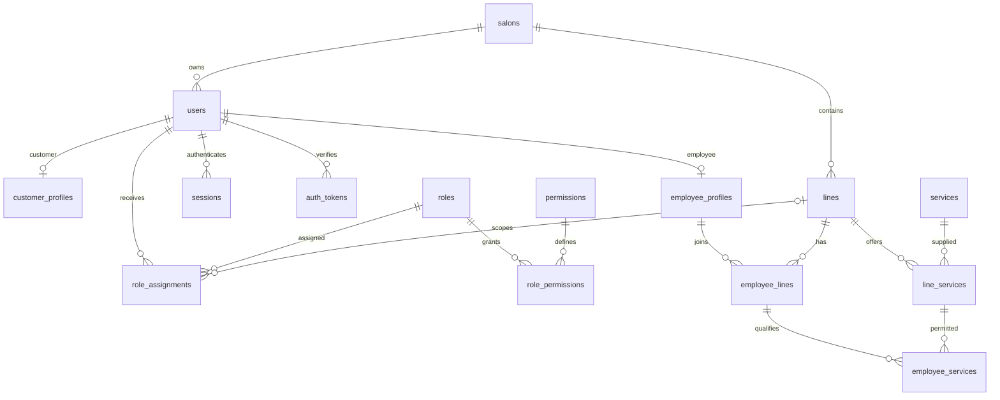
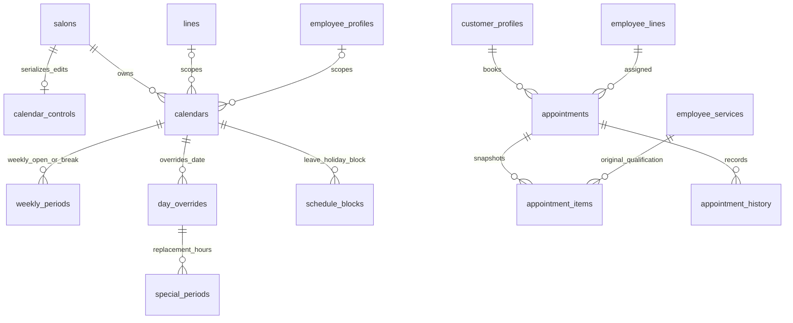
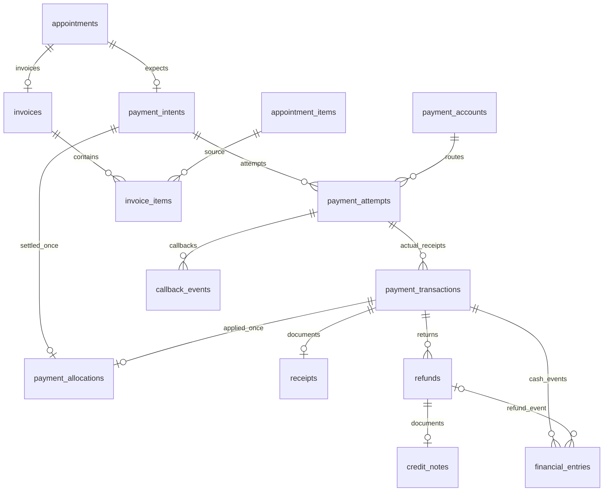
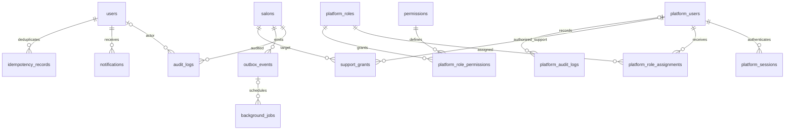

# ERD مرحلهٔ ۲

این نمودارها روابط اصلی مرحلهٔ ۲ را نشان می‌دهند. تمام FKهای بین موجودیت‌های یک سالن، tenant_id را نیز دارند. طرح جاری پس از مرحلهٔ ۹ شامل ۵۳ جدول است؛ جزئیات و دو جدول شبیه‌ساز پرداخت در [ERD کامل](schema-erd.mmd) و [فرهنگ داده](schema-dictionary.md) آمده‌اند.

## هویت، نقش و کاتالوگ

Employee و Customer قابل جمع روی یک User هستند. یک RoleAssignment یا در سطح Tenant است یا یک Line مشخص. مدیر پلتفرم از این Userها و نقش‌ها جداست.

## تقویم و نوبت

هر Appointment دارای Range محاسبه‌شدهٔ اشغال و قید عدم تداخل متخصص است. صفر قلم در سطح FK ممکن است؛ Service مرحلهٔ ۸ ایجاد نوبت با حداقل یک قلم و مجموع صحیح را در یک تراکنش تضمین می‌کند.

## پرداخت و اسناد

یک PaymentAttempt ممکن است بیش از یک دریافت واقعی داشته باشد؛ این دریافت‌ها حذف نمی‌شوند. PaymentAllocation حداکثر یک تسویهٔ معتبر برای سفارش می‌پذیرد. مبلغ ناسازگار می‌تواند به‌عنوان دریافت واقعی برای رسیدگی ثبت شود، ولی قابل تخصیص به سفارش نیست.

## عملیات و پلتفرم

شناسهٔ entity در Audit یک مرجع عمومی برای چند نوع موجودیت است و FK مستقیم ندارد؛ حذف موجودیت نباید رخداد Audit را از بین ببرد. این استثنا فقط برای ارجاع حسابرسی است و در روابط مالی و رزرو استفاده نشده است.
